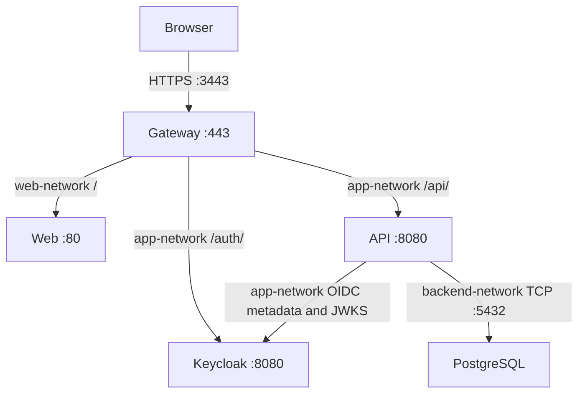

# SecureBank

SecureBank is a security-focused banking API and browser application built with .NET, PostgreSQL, Keycloak, Nginx, and Docker. It models account ownership, money transfers, beneficiaries, staff access, and the authorization boundaries expected in a financial system.

The project is designed around **secure-by-default principles** and is intended for controlled development and lab use, not production banking. Its purpose is to demonstrate application-security engineering and provide a realistic target for authorization testing, traffic inspection, threat modelling, network-security experiments, API assessment, automated security scanning, hardening, and defensive writeups.

## What It Demonstrates

- OpenID Connect login with Keycloak and Authorization Code Flow with PKCE
- JWT issuer, audience, lifetime, and signing-key validation
- Separation of the public OIDC issuer from internal metadata and JWKS retrieval
- HTTPS for browser-facing traffic
- Nginx TLS termination and reverse proxying
- Customer and bank-staff role separation
- Object-level authorization on account resources
- Ownership checks on transfers and beneficiaries
- Idempotent money transfers
- Transactional persistence
- Request validation
- Problem Details responses
- Rate limiting
- Security headers
- Health checks
- Non-root containers
- Protected data-protection keys
- Restricted Docker service exposure
- Segmented Docker bridge networks and restricted database access
- Dedicated TLS gateway and isolated static frontend
- Dynamic upstream DNS resolution
- Linux routing and Docker-managed firewall inspection
- Separate local-development and security-lab deployment profiles
- Host firewall enforcement for management-plane access
- Firewall logging for blocked traffic
- Externally observable API security boundaries
- Automated application-security scanning
- Manual validation of scanner findings
- SPA routing and soft-404 handling
- Nginx proxy-location precedence
- Unit and integration tests around authorization-sensitive behavior

## User Experiences

### Customer Banking

Customers can:

- View only their own accounts and balances
- Create transfers from accounts they own
- Save and remove their own beneficiaries
- Review incoming and outgoing account activity
- Filter, sort, and paginate transfer history

### Staff Operations

Support staff receive a separate dashboard and can:

- Look up a customer by Keycloak user ID
- Review that customer's account numbers, balances, and status
- Use a read-only support workflow

Staff cannot initiate customer transfers or manage customer beneficiaries.

The frontend reflects this boundary, but the API remains the authority.

## Architecture

The deployment separates browser-facing TLS termination from static frontend hosting. Both Nginx services use `nginx:1.30.8-alpine`.



The gateway belongs to both the web and app networks; the API belongs to both the app and backend networks. The diagram shows application traffic; the membership table below is authoritative for network attachments.

| Service | `web-network` | `app-network` | `backend-network` |
| --- | :---: | :---: | :---: |
| Gateway | Yes | Yes | — |
| Web | Yes | — | — |
| API | — | Yes | Yes |
| Keycloak | — | Yes | — |
| PostgreSQL | — | — | Yes |
| Driver | bridge | bridge | bridge |
| `internal` | true | false | true |

- **Gateway:** terminates TLS and proxies requests to the appropriate service.
- **Web:** serves the React build and handles SPA routing; no published ports or TLS key mounts.
- **API:** implements business logic and authorization, accesses PostgreSQL and retrieves Keycloak metadata.
- **Keycloak:** provides identity and OIDC services.
- **PostgreSQL:** persists application data on the isolated backend network.

React executes in the browser, which sends API and authentication requests through the gateway. The Web container does not need direct access to either service.

Local development: `https://localhost:3443`  
Security lab: `https://securebank.lab:3443`

The internal networks restrict cross-network forwarding and normal outbound connectivity for internal-only containers. The app network remains non-internal, so gateway, API and Keycloak are expected to retain outbound connectivity. This is network segmentation, not a complete per-service firewall: services sharing a network may communicate, and a compromised API can still reach PostgreSQL.

## OIDC Architecture

Local public issuer:

```text
https://localhost:3443/auth/realms/securebank
```

Lab public issuer:

```text
https://securebank.lab:3443/auth/realms/securebank
```

The API validates the public issuer while retrieving metadata and signing keys from Keycloak through its internal Docker address.

This separates:

```text
public token identity
```

from:

```text
internal service discovery
```

without weakening JWT validation.

## Backend Structure

```text
src/
|-- SecureBank.Api
|-- SecureBank.Application
|-- SecureBank.Application.Abstractions
|-- SecureBank.Domain
`-- SecureBank.Infrastructure

frontend/
infrastructure/keycloak/
infrastructure/nginx/
scripts/
tests/
```

Commands and queries pass through validation, authorization, logging, performance, and transaction behaviors before reaching domain and persistence code.

## Network Exposure Model

| Service | Container Port | Host Exposure | Purpose |
| --- | ---: | --- | --- |
| Gateway HTTPS | `443` | `0.0.0.0:3443` / `[::]:3443` | Primary external entry point |
| Gateway HTTP | `80` | `127.0.0.1:3000` | Local redirect testing |
| Web HTTP (static frontend) | `80` | Not published | Internal static file serving |
| API HTTPS | `8443` | `127.0.0.1:8443` | Local Swagger/direct API |
| API HTTP | `8080` | Not published | Internal reverse-proxy/API communication |
| Keycloak HTTP | `8080` | `127.0.0.1:8081` | Local development/admin access |
| PostgreSQL | `5432` | Not published | Internal database communication |

### Lab Attack Surface

The following scan results predate the gateway/network refactor; a fresh external scan is planned.

Before host firewall hardening:

```text
22/tcp   open
3443/tcp open
```

After UFW:

```text
22/tcp   filtered
3443/tcp open
```

The SSH service remains running locally while access from the attacker-facing lab network is filtered.

Backend service ports remain unavailable remotely.

## Security Boundaries

| Resource or operation | Customer | Support/Admin | Enforcement |
| --- | ---: | ---: | --- |
| List own accounts | Yes | No customer context | Authenticated query scoped to token subject |
| Read account by ID | Own only | Any customer account | Resource-based authorization |
| Create transfer | From owned account | No | Ownership check |
| View transfer history | Own accounts only | No | User/account-scoped query |
| Manage beneficiaries | Own only | No | User-scoped commands and queries |
| Look up customer accounts | No | Yes | Staff policy and role requirement |

The frontend is not a security boundary.

Authorization decisions are enforced on the server.

## API Identity Model

Normal customer collection requests do not include a client-supplied user ID.

For example:

```http
GET /api/accounts
```

uses:

```http
Authorization: Bearer <JWT>
```

The server derives identity from the authenticated user context.

Conceptually:

```text
JWT subject
    │
    ▼
UserContext
    │
    ▼
user-scoped query
```

This reduces client control over identity selection.

However, object-level identifiers still appear in resource operations and require explicit authorization checks.

## Object-Level Authorization Boundaries

External API reconnaissance identified several important object-level authorization boundaries.

### Transfer Source Account

```http
POST /api/transfers
```

contains:

```json
{
  "sourceAccountId": "...",
  "destinationAccountNumber": "...",
  "amount": 5,
  "currency": "EUR"
}
```

`sourceAccountId` is client supplied.

The server must therefore verify:

```text
authenticated subject
+
sourceAccountId
↓
account ownership
```

This boundary was explicitly tested in the security lab.

Using one customer's bearer token with another customer's `sourceAccountId` and a fresh `Idempotency-Key` resulted in:

```http
HTTP/1.1 403 Forbidden
```

```json
{
  "title": "Access forbidden.",
  "status": 403,
  "detail": "You are not allowed to transfer from this account.",
  "instance": "/api/transfers"
}
```

This confirmed that transfer-source ownership is enforced on the server.

### Beneficiary Deletion

```http
DELETE /api/beneficiaries/{id}
```

contains a client-controlled beneficiary identifier.

The server must verify:

```text
authenticated subject
+
beneficiary ID
↓
beneficiary ownership
```

This boundary was also explicitly tested.

A deletion request authenticated as one customer was modified to reference another customer's beneficiary ID.

The API returned:

```http
HTTP/1.1 404 Not Found
```

```json
{
  "title": "Resource not found.",
  "status": 404,
  "detail": "The beneficiary was not found.",
  "instance": "/api/beneficiaries/<foreign-beneficiary-id>"
}
```

The foreign beneficiary remained intact after the request.

This confirmed that unauthorized beneficiary deletion was prevented.

## Validated Security Controls

The lab currently includes explicit validation of several security controls.

### Transfer Ownership

```text
customer A token
+
customer B sourceAccountId
+
fresh Idempotency-Key
↓
403 Forbidden
```

Result:

```text
cross-user transfer prevented
```

### Beneficiary Ownership

```text
customer A token
+
customer B beneficiary ID
↓
404 Not Found
```

Verification:

```text
beneficiary remained intact
```

Result:

```text
cross-user deletion prevented
```

### Host Exposure

```text
backend container service
≠
remotely reachable host service
```

PostgreSQL has no published host port. API HTTP is internal; its HTTPS development endpoint is published on host loopback only. The dedicated gateway provides the public application entry point.

### Firewall Segmentation

```text
sshd running
+
22/tcp filtered from attacker network
```

Management-plane access can therefore be restricted independently from service state.

### Network Segmentation Verification (2026-11-26)

The following observations were made on the Ubuntu lab after the three-network refactor. Container addresses are assigned dynamically; the addresses below are a snapshot, not configuration requirements.

| Test | Observed result |
| --- | --- |
| Web → gateway `/healthz` | Healthy |
| Web → API / Keycloak DNS | SERVFAIL |
| Web → API / Keycloak direct IP, TCP 8080 | Network unreachable |
| Web → PostgreSQL direct IP, TCP 5432 | Network unreachable |
| Web → `8.8.8.8` (ICMP) | Network unreachable |
| Ubuntu host → `8.8.8.8` (ICMP) | Successful |
| Gateway → PostgreSQL direct IP, TCP 5432 | Timed out |
| Gateway route lookup for PostgreSQL | Route via app-network bridge exists |

Observed subnets: `app-network` = `172.18.0.0/16`, `backend-network` = `172.19.0.0/16`, `web-network` = `172.21.0.0/16`.

Example diagnostic commands (run from the Compose project directory):

```bash
docker network inspect securebank_web-network
docker compose exec web ip route
docker compose exec web nslookup api
docker compose exec gateway ip route get 172.19.0.2
docker compose exec gateway nc -zvw 3 172.19.0.2 5432
sudo iptables -L DOCKER-INTERNAL -n -v --line-numbers
```

The Web routing table contained only its directly connected subnet. The gateway had a default route via the app network, but Docker's `DOCKER-INTERNAL` chain contained a drop rule for traffic entering the backend bridge from outside its subnet. Its nonzero counter was consistent with blocked traffic; a controlled before/after counter comparison is still to be confirmed.

Both Nginx configurations passed syntax validation during the gateway refactor. Container health and network membership were inspected after deployment. Full end-to-end authentication, fresh external enumeration, API-to-database connectivity revalidation and dynamic DNS recovery with a confirmed IP change remain follow-up checks after the final segmentation change.

## Run Locally

### Requirements

- Docker Desktop with Docker Compose
- .NET 10 SDK
- PowerShell
- Ports `3000`, `3443`, `8081`, and `8443`

### Development Certificates

Run:

```powershell
.\scripts\setup-dev-cert.ps1
```

Generated local material:

```text
.certs/
|-- securebank.pfx
|-- securebank.crt
`-- securebank.key

.env
```

These files are excluded from Git.

`.env.example` contains:

```dotenv
SECUREBANK_CERT_PASSWORD=
```

Do not commit private keys or populated secrets.

### Start Local Environment

```powershell
docker compose up --build
```

Open:

- `https://localhost:3443`
- `https://localhost:8443/swagger`
- `https://localhost:3443/auth/admin/master/console/`

### Demo Identities

The imported development realm provides customer and support-agent demo identities (`nina` and `staff1`) and a development administrator. Consult the local realm and Compose configuration for fixture credentials. These are for disposable development/lab use only; do not reuse them in production or expose the lab publicly.

### Reset Local Environment

**Warning:** `--volumes` deletes persisted application and identity data. Use only for an intentional disposable lab reset.

```powershell
docker compose down --volumes
docker compose up --build
```

Default realm:

```text
infrastructure/keycloak/securebank-realm.json
```

## Security Lab Deployment

```text
                    Internet
                       │
                 VirtualBox NAT
                   │         │
                Kali       Ubuntu
                   │         │
                   └────┬────┘
                        │
                 securebank-lab
                 192.168.56.0/24
```

Addressing:

```text
Kali: 192.168.56.10
Ubuntu: 192.168.56.20
Hostname: securebank.lab
```

Application:

```text
https://securebank.lab:3443
```

### Lab Compose

```text
docker-compose.yml
docker-compose.lab.yml
```

Lab-specific Keycloak realm:

```text
infrastructure/keycloak/securebank-realm.lab.json
```

Start:

```bash
docker compose \
  -f docker-compose.yml \
  -f docker-compose.lab.yml \
  up -d --build
```

Reset (destructive; removes persisted volumes):

```bash
docker compose \
  -f docker-compose.yml \
  -f docker-compose.lab.yml \
  down --volumes
```

The lab override is required when running SecureBank on the Ubuntu target.

It provides the correct externally visible hostname and Keycloak proxy configuration for:

```text
https://securebank.lab:3443
```

Launching only the base Compose file can cause Keycloak to generate URLs using the local-development host instead of the lab hostname.

## Host Firewall

Lab interface:

```text
enp0s8
192.168.56.20/24
```

Policy:

```bash
sudo ufw default deny incoming
sudo ufw default allow outgoing
```

Allow SecureBank:

```bash
sudo ufw allow in on enp0s8 to any port 3443 proto tcp
```

Block/log SSH:

```bash
sudo ufw deny in on enp0s8 log proto tcp to any port 22
```

Result:

```text
22/tcp   filtered
3443/tcp open
```

### Docker and UFW interaction

UFW restricts host management-plane access, including SSH on `enp0s8`. Docker also manages forwarding and NAT rules for bridge networks and published ports. Published container traffic can traverse `FORWARD` rather than the host `INPUT` chain; an INPUT rule alone is not proof of container-port isolation.

The lab inspection identified `DOCKER-USER`, `DOCKER-FORWARD` and `DOCKER-INTERNAL` chains. Network isolation is enforced through routing and Docker-managed filtering. The observed `DOCKER-USER` chain was empty. NAT packet flow and a fresh external scan are planned; no comprehensive custom egress firewall is claimed.

## HTTPS and Reverse Proxying

Local:

```text
https://localhost:3443
```

Lab:

```text
https://securebank.lab:3443
```

API:

```text
https://<public-host>:3443/api/*
```

internally:

```text
http://api:8080
```

Keycloak:

```text
https://<public-host>:3443/auth/*
```

internally:

```text
http://keycloak:8080
```

The gateway configuration lives at `infrastructure/nginx/nginx.conf` and is mounted read-only. The frontend has its own Nginx configuration at `frontend/nginx.conf`.

| Browser path | Gateway upstream | URI handling |
| --- | --- | --- |
| `/` | `web:80` | Preserve path |
| `/api/` | `api:8080` | Preserve `/api/` prefix |
| `/auth/` | `keycloak:8080` | Strip `/auth/` prefix |

The gateway forwards the public port (`3443`) to API and Keycloak and the `/auth` prefix to Keycloak. Gateway TLS uses TLS 1.2/1.3. The gateway's `/healthz` checks the gateway itself, not upstream availability.

## Nginx Security Hardening

### Dynamic Upstream DNS

Docker service IP addresses can change when containers are recreated. The gateway uses Docker's embedded DNS resolver and dynamically resolved upstream groups rather than relying on startup-only resolution.

```nginx
resolver 127.0.0.11 valid=10s ipv6=off;
resolver_timeout 5s;

upstream api_backend {
    zone api_backend 64k;
    server api:8080 resolve;
}
```

Equivalent upstream groups are configured for Web and Keycloak. This is designed to refresh upstream addresses without restarting Nginx; recovery after a confirmed address change is a planned verification.

### Version Disclosure

Initial response:

```text
Server: nginx/1.29.8
```

Configuration:

```nginx
server_tokens off;
```

Verified result:

```text
Server: nginx
```

### SPA Fallback Handling

The frontend uses client-side routing.

A standard SPA fallback:

```nginx
location / {
    try_files $uri $uri/ /index.html;
}
```

allows extensionless application routes to load correctly.

However, automated security testing showed that missing file-like paths could also fall back to `index.html` and return:

```http
HTTP/1.1 200 OK
Content-Type: text/html
```

This caused scanners to report nonexistent backup files, certificate files, archives, and other resources as apparent findings.

File-like paths were therefore changed to require a real file:

```nginx
location ~ \.[^/]+$ {
    try_files $uri =404;
}
```

This preserves normal SPA routing while causing nonexistent file-like resources to return:

```http
404 Not Found
```

instead of the application shell.

### Proxy Location Precedence

Before the gateway split, the static-file regex and API/Keycloak proxy locations shared one Nginx configuration. Explicit `^~` prefix locations prevented file-like Keycloak resources from being intercepted by the regex.

The current architecture separates these responsibilities: the gateway routes `/api/` and `/auth/` to their respective upstreams, while the Web container handles static files and SPA fallback. The earlier precedence fix is retained here as historical context, not as a requirement for a shared proxy/static server.

### Security Header Scope

The Web container applies frontend-specific security headers at server scope. These include controls such as:

```text
X-Content-Type-Options
X-Frame-Options
Referrer-Policy
Permissions-Policy
Content-Security-Policy
```

Nginx location matching and internal redirects were verified because moving requests between locations can affect `add_header` inheritance.

The frontend Content Security Policy is not blindly imposed on Keycloak pages because the authentication UI has different script and resource requirements.

Security headers are therefore scoped according to the content being served rather than applied globally without context.

## PostgreSQL

PostgreSQL is not published to the host.

API connection:

```text
postgres:5432
```

Testing confirmed that removing host database exposure did not break application functionality.

## API Surface

| Method | Route | Purpose |
| --- | --- | --- |
| `GET` | `/api/auth/me` | Current authenticated identity |
| `GET` | `/api/accounts` | Current customer's accounts |
| `GET` | `/api/accounts/{id}` | Object-authorized account |
| `GET` | `/api/transfers` | Current customer's transfer history |
| `POST` | `/api/transfers` | Create transfer |
| `GET` | `/api/beneficiaries` | Current customer's beneficiaries |
| `POST` | `/api/beneficiaries` | Add beneficiary |
| `DELETE` | `/api/beneficiaries/{id}` | Remove owned beneficiary |
| `GET` | `/api/staff/accounts/{userId}` | Staff customer lookup |
| `GET` | `/health/live` | Process liveness |
| `GET` | `/health/ready` | Database readiness |

## Externally Observed Customer API

Burp Suite reconnaissance confirmed the frontend actively uses:

```text
GET    /api/auth/me
GET    /api/accounts
GET    /api/transfers
POST   /api/transfers
GET    /api/beneficiaries
POST   /api/beneficiaries
DELETE /api/beneficiaries/{id}
```

Observed client-controlled inputs include:

```text
page
pageSize
sortBy
sortDirection
sourceAccountId
destinationAccountNumber
amount
currency
beneficiaryId
accountNumber
nickname
Idempotency-Key
```

## Transfer Idempotency

Transfer requests include:

```http
Idempotency-Key: <UUID>
```

This is intended to prevent duplicate execution of the same logical transfer.

During BOLA testing, replaying a modified transfer request while reusing an existing idempotency key returned the previously created:

```text
transferId
```

instead of processing the request as a new transfer.

Conceptually:

```text
same Idempotency-Key
+
modified request body
↓
existing transfer result returned
```

For authorization testing, a fresh idempotency key was therefore required.

This observation does not replace a dedicated replay/idempotency assessment.

Request-fingerprint behavior, duplicate submission semantics, and replay resistance remain candidates for a separate lab.

## Automated Security Scanning

SecureBank has also been evaluated using automated web-security scanning in the isolated lab.

Testing included:

```text
passive
safe
aggressive
```

scan profiles.

The scanner was used together with external tools including:

```text
Nmap
Nikto
sqlmap
SSL/TLS tooling
```

Automated findings were treated as candidates rather than automatically accepted vulnerabilities.

### Scanner Validation Principle

```text
scanner finding
↓
manual reproduction
↓
context analysis
↓
confirmed issue
or
false positive
```

### SPA Soft-404 Findings

Automated scans initially reported a large number of apparent sensitive files and management endpoints.

Examples included paths resembling:

```text
/admin
/administrator
/actuator
/actuator/env
/metrics
/backup.tar
/site.war
/database.jks
```

Manual `curl` validation showed that many nonexistent paths returned the same SecureBank SPA shell.

For extensionless routes, this remains an expected consequence of client-side routing.

For missing file-like resources, Nginx was hardened to return a real `404`.

This significantly reduced scanner noise.

### Remaining Expected or Hardening Findings

Examples of scanner observations from the earlier assessment include (not yet revalidated after the infrastructure refactor):

```text
self-signed development certificate
missing HSTS
missing Cross-Origin-Opener-Policy
missing Cross-Origin-Resource-Policy
missing security.txt
```

The self-signed certificate is expected in the controlled lab.

Other findings are treated as hardening items and evaluated in context rather than automatically classified as exploitable vulnerabilities.

Detailed scanner methodology and before/after results are documented in the separate cybersecurity portfolio.

## Testing

Backend:

```powershell
dotnet test SecureBank.slnx
```

Frontend:

```powershell
cd frontend
npm install
npm run build
```

The current test suite covers domain behavior, validation, transaction handling, account isolation, and authorization-sensitive behavior.

## Security Testing

The isolated lab currently supports:

- traffic analysis
- Docker exposure testing
- service enumeration
- TLS inspection
- host firewall testing
- API reconnaissance
- authenticated Burp proxying
- object-identifier mapping
- horizontal authorization testing
- BOLA/IDOR validation
- authorization-boundary analysis
- transfer idempotency observation
- automated web-security scanning
- scanner false-positive validation
- Nginx routing analysis
- security-header verification
- controlled security testing
- remediation verification

### Completed Security Work

- HTTP vs HTTPS traffic analysis
- TLS inspection
- Docker service exposure analysis
- PostgreSQL host-exposure removal
- Nmap service enumeration
- HTTP/TLS metadata enumeration
- Nginx version-disclosure hardening
- UFW host firewall configuration
- SSH management-plane filtering
- firewall logging
- authenticated API reconnaissance with Burp Suite
- customer API attack-surface mapping
- JWT-authentication observation
- object-identifier mapping
- transfer ownership-boundary identification
- beneficiary ownership-boundary identification
- transfer-source BOLA/IDOR testing
- beneficiary BOLA/IDOR testing
- cross-user transfer authorization verification
- cross-user beneficiary-deletion authorization verification
- idempotency-control identification
- transfer idempotency behavior observation
- automated passive/safe/aggressive web scanning
- scanner false-positive validation
- SPA soft-404 investigation
- file-like missing-resource hardening
- Nginx proxy-location precedence hardening
- frontend security-header verification
- Keycloak/frontend CSP separation
- remediation verification after Nginx changes

Additional infrastructure work completed on 2026-11-26:

- Dedicated gateway and static frontend separation
- Nginx upgrade to `1.30.8-alpine` for both services
- Dynamic upstream DNS configuration
- Three-network Docker segmentation and obsolete-network cleanup
- Network membership, routing table and default route inspection
- Direct-IP and DNS isolation testing
- Web outbound connectivity restriction verification
- Docker-managed iptables chain and rule inspection

### Planned Security Labs

- Post-refactor end-to-end login and API verification
- API-to-PostgreSQL and API-to-Keycloak connectivity revalidation
- Dynamic upstream DNS recovery with a confirmed IP change
- NAT and published-port packet-flow inspection
- Fresh external port scan and security-header verification
- Outbound connectivity assessment for app-network services
- Review of development credentials and secret management

- broken function-level authorization / vertical authorization testing
- JWT validation and tampering
- dedicated transfer replay and idempotency verification
- rate-limit verification
- malformed input/error handling
- mass-assignment testing
- CORS validation
- security-header review
- dependency scanning
- secret scanning
- container scanning
- static analysis
- Wazuh monitoring
- detection engineering

All offensive testing is restricted to systems where explicit authorization exists.

## Related Security Portfolio

The application remains in this repository.

Security methodology, evidence, findings, screenshots, remediation comparisons, and lab writeups are stored separately in the cybersecurity portfolio repository.

This separation keeps application implementation and security-assessment documentation independently understandable while allowing them to reference each other.

## Project Status

SecureBank serves as a controlled security-testing target with a segmented infrastructure. The latest refactor is deployed; complete post-refactor end-to-end and external regression testing is pending.

The environment currently includes:

- reproducible Keycloak configuration
- separate local and VM-lab deployment profiles
- PostgreSQL
- HTTPS
- OIDC/JWT authentication
- role-based authorization
- object-level authorization controls
- validated transfer ownership enforcement
- validated beneficiary ownership enforcement
- dedicated Nginx gateway and static frontend
- three segmented Docker bridge networks
- dynamic upstream DNS configuration
- verified frontend network isolation
- restricted service exposure
- isolated Kali attacker VM
- Ubuntu target VM
- host firewalling
- Nginx hardening
- SPA-aware routing behavior
- separate API/Keycloak proxying and SPA file handling
- scoped frontend security headers
- externally observable API attack surface
- Burp-compatible authenticated testing workflow
- automated web-security scanning workflow
- manual scanner-result validation
- automated backend security and authorization tests

The surrounding security portfolio now evaluates SecureBank from both network and application-security perspectives, while SecureBank itself remains the implementation-focused repository for the application, infrastructure, and defensive controls.